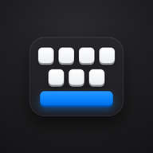

# 🇳🇵 Siriri Nepali Keyboard

<p align="center">
  
</p>

<p align="center">
  <b>A lightweight, high-performance, offline & privacy-first Nepali and Hindi keyboard for Android.</b><br />
  Powered by an ultra-fast native Rust core and a zero-dependency, canvas-drawn Kotlin shell.
</p>

<p align="center">
  <a href="https://github.com/bishal-majhi/siriri-nepali-keyboard/releases"></a>
  <a href="https://developer.android.com"></a>
  <a href="PRIVACY.md"></a>
  <a href="https://www.rust-lang.org"></a>
  <a href="https://kotlinlang.org"></a>
  <a href="https://github.com/bishal-majhi/siriri-nepali-keyboard"></a>
</p>

---

## ✨ Features at a Glance

### 🔒 Privacy by Construction
* **Zero Permissions:** The app's manifest declares **no permissions** (`INTERNET`, `ACCESS_NETWORK_STATE`, and storage permissions are omitted). Android physically forbids socket connections.
* **100% On-Device:** Keystrokes, phonetic transliterations, and learned words never leave your phone.
* **Sensitive Field Protection:** Word learning is automatically disabled in password, PIN, credit card, e-mail, URL, and incognito fields (`IME_FLAG_NO_PERSONALIZED_LEARNING`).
* **Cloud Isolation:** `allowBackup=false` and strict extraction rules prevent cloud sync or device-transfer leakage.

### 🌐 Four Seamless Typing Modes
Cycle modes on-the-fly with a single tap on the bottom language key:
1. **English (`En`)**: Standard Latin QWERTY layout with dynamic next-word predictions.
2. **Traditional Nepali (`ने`)**: Full Devanagari layout with standalone vowels, matras, halant, and Nepali numerals (`१–०`).
3. **Hindi Roman (`Hi`)**: Phonetic Roman transliteration with full nukta support (`क़ ख़ ग़ ज़ ड़ ढ़ फ़`) and the Indian Rupee sign (`₹`).
4. **Roman Nepali (`Np`)**: Natural phonetic transliteration (`namaste` → `नमस्ते`, `dhanyabad` → `धन्यवाद`).

### ⚡ Blazing Fast Native Engine
* Transliteration rules, candidate scoring, prefix searching, and dictionary management are written in **pure Rust** (`rust-core/`).
* Compiled into optimized native ARM64, ARMv7, and x86_64 libraries (`libsiriri_core.so`) for sub-millisecond response times.
* Zero third-party Android runtime dependencies — pure Kotlin calling into native code via JNI.

### 😀 Offline Emoji Suite & Keyword Suggestions
* Built-in 8-category offline emoji panel with persistent Recent history.
* **Contextual Emoji Suggestions:** Type keywords in English, Roman Nepali, or Devanagari to trigger relevant emojis in the suggestion bar (e.g., `haha` → 😂, `love` / `maya` → ❤️, `namaste` → 🙏).

### 📋 Clipboard Quick-Paste Chip
* Copy text in any application and switch to Siriri to see a non-intrusive paste chip: `📋 Paste: "<preview>"`.
* One tap commits the text instantly.
* Automatically dismisses upon typing, after 60 seconds, or via the `✕` dismiss button.
* Never activated in password or incognito fields with zero disk history retention.

### 🔄 Intuitive Gestures & Key Mechanics
* **Word-by-Word Backspace Deletion:** Tap to backspace one character; hold for 1.2s to smoothly delete entire words with tactile haptics.
* **Spacebar Cursor Glide:** Slide horizontally across the spacebar to glide the cursor precisely through text.
* **iOS-Style Flared Popups:** Connected keyhole preview bubbles appear above touched keys with instant tactile release.
* **Top-Row Quick Numbers:** Long-press any key on the top row to quickly type digits `1–0` (or `१–०`).
* **Double-Space Period:** Double-tapping space inserts `. ` (in English) or `। ` (in Devanagari modes).

### 📱 Responsive Across All Screens
* Dynamically adapts row heights, key radiuses, font sizes, and layout gaps for portrait phones, landscape mode, and 7" to 11" tablets.
* Respects display cutouts, notches, and navigation bar insets seamlessly.

---

## 📖 Roman Transliteration Cheatsheet

| Input | Output | Category | Examples |
|---|---|---|---|
| `a`, `aa` / `A` | अ, आ | Vowels | `aamaa` → आमा |
| `i` / `ee`, `u` / `oo` | इ / ई, उ / ऊ | Vowels | `geet` → गीत, `doodh` → दूध |
| `e`, `ai`, `o`, `au` | ए, ऐ, ओ, औ | Diphthongs | `ek` → एक, `aushadhi` → औषधि |
| `k`, `kh`, `g`, `gh` | क, ख, ग, घ | Velar Consonants | `kukur` → कुकुर, `ghar` → घर |
| `ch`, `chh`, `j`, `jh` | च, छ, ज, झ | Palatal Consonants | `chha` → छ, `jhilke` → झिल्के |
| `T`, `Th`, `D`, `Dh` | ट, ठ, ड, ढ | Retroflex Consonants | `Thik` → ठीक, `Dukkur` → डुकुर |
| `t`, `th`, `d`, `dh`, `n` | त, थ, द, ध, न | Dental Consonants | `dhanyabad` → धन्यवाद |
| `p`, `ph` / `f`, `b`, `bh`, `m` | प, फ, ब, भ, म | Labial Consonants | `pani` → पानी, `bhaat` → भात |
| `y`, `r`, `l`, `w` / `v` | य, र, ल, व | Approximants | `maya` → माया, `lekh` → लेख |
| `sh`, `Sh`, `s`, `h` | श, ष, स, ह | Sibilants | `shanti` → शान्ति, `saathi` → साथी |
| `ksh`, `tr`, `gy` | क्ष, त्र, ज्ञ | Conjuncts | `gyaan` → ज्ञान, `mitra` → मित्र |
| `M` / `ng`, `MM`, `H` | ं (anusvara), ँ (chandrabindu), ः (visarga) | Modifiers | `rang` → रंग, `haase` → हाँसे |
| `q` | ् (explicit virama / halant) | Halant | `khatq` → खत् |

---

## 🏗️ Architecture

```
siriri-nepali-keyboard/
├── rust-core/                   # High-performance offline language core (Rust 2021)
│   ├── src/lib.rs               # Library entry point and module bindings
│   ├── src/layout.rs            # Keyboard layout definitions & key weights
│   ├── src/translit.rs          # Roman -> Devanagari transliteration & phonetic rules
│   ├── src/store.rs             # Privacy-first word frequency store & LRU pruning
│   └── src/jni_api.rs           # Native JNI bridge exports
│
├── app/                         # Lightweight Android IME shell (Kotlin)
│   ├── src/main/kotlin/
│   │   ├── SiririKeyboardService.kt  # Thin InputMethodService managing editor connections
│   │   ├── KeyboardView.kt           # Pure Canvas custom view (zero view inflation)
│   │   ├── SettingsActivity.kt       # Modern card-based settings dashboard
│   │   ├── EmojiCatalog.kt           # Offline emoji repository & keyword matcher
│   │   ├── KeyTheme.kt               # Dynamic light/dark theme tokens
│   │   ├── Layout.kt                 # Geometry computation & key hitboxes
│   │   ├── Prefs.kt                  # Local SharedPreferences manager
│   │   ├── Native.kt                 # JNI extern declarations
│   │   └── Types.kt                  # Enums (Mode, ShiftState, ReturnStyle)
│   └── src/main/AndroidManifest.xml  # Zero permissions declared
```

---

## 🛠️ Building from Source

### Prerequisites
1. **JDK 17 or 21** (`JAVA_HOME`)
2. **Android SDK & NDK** (`ANDROID_HOME`, `ANDROID_NDK_HOME`, NDK 27+)
3. **Rust Toolchain**:
   ```bash
   rustup target add aarch64-linux-android armv7-linux-androideabi x86_64-linux-android
   cargo install cargo-ndk
   ```

### 1. Run Core Rust Tests
```bash
cargo test --manifest-path rust-core/Cargo.toml
```
*(All 23 unit tests run in <0.1s)*

### 2. Build Signed Release APK & Bundle
```bash
./gradlew :app:bundleRelease :app:assembleRelease
```
- **Universal APK:** `app/build/outputs/apk/release/app-release.apk`
- **Google Play Bundle:** `app/build/outputs/bundle/release/app-release.aab`

---

## 📋 Privacy Policy

Please see the comprehensive [Privacy Policy](PRIVACY.md). Siriri Keyboard does not collect, log, track, or share any personal data.

---

## 📄 License & Attribution

Distributed under the open-source **GPL-3.0 License** (or MIT where applicable). Free for personal and commercial use.

*Made with pride for Nepal 🇳🇵*
